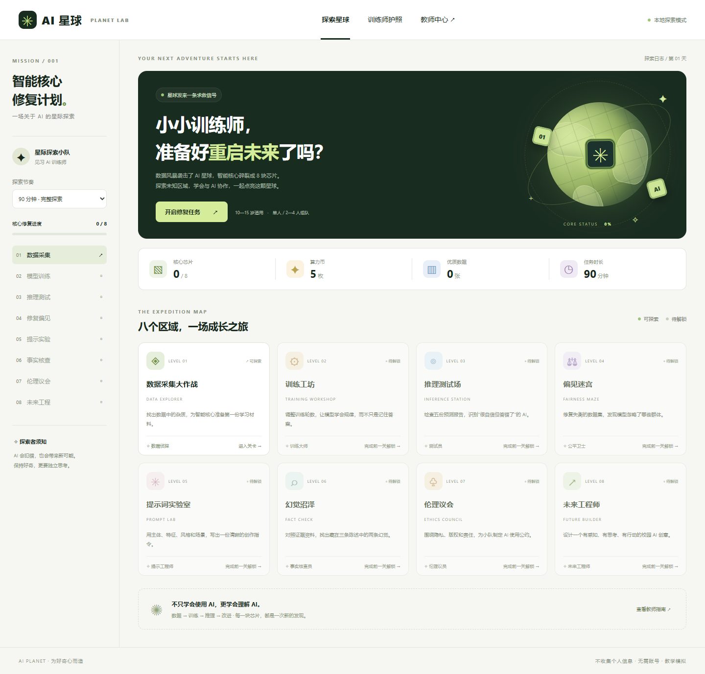

# AI星球：智能核心修复计划

**一个面向 10—15 岁学生的 AI 科普闯关游戏。** 玩家化身 AI 训练师，在八个区域中收集芯片，修复被数据风暴破坏的智能核心。

> 数据 → 训练 → 推理 → 改进。学会使用 AI，也学会质疑、核实与负责。



## 快速开始

需要 **Node.js 20 或更新版本**，无需安装依赖、无需 API 密钥。

```bash
git clone https://github.com/liyancheng071007/AI-planet.git
cd AI-planet
npm start
```

浏览器打开 **http://127.0.0.1:4173**。停止服务：在终端按 `Ctrl+C`。

本项目使用浏览器 ES Modules，请通过 HTTP 服务打开，不要双击 `index.html`。端口可通过环境变量 `PORT` 调整；例如 PowerShell：`$env:PORT=4174; npm start`。

## 游戏是什么样的？

- **星球任务地图**：八个区域顺序解锁，收集芯片逐步恢复核心。
- **八种互动任务**：清洗数据、调训练轮数、核对预测、平衡数据、写提示词、对照证据、制定公约、设计校园方案。
- **训练师护照**：保存徽章、每关得分、作品与回答；支持 JSON 导出和浏览器打印。
- **资源机制**：初始 5 枚算力币，可换提示与辅助解题；首次通关获得奖励与随机事件。
- **课堂支持**：45 分钟、90 分钟、4 课时节奏提示，教师中心、角色分工与合作复盘。
- **无需账号**：进度仅保存在当前浏览器的 `localStorage`；支持手机、平板、电脑及键盘操作。

### 八个关卡

| 关卡 | 互动任务与通关条件 | 核心概念 | 徽章 |
| --- | --- | --- | --- |
| 01 数据采集大作战 | 处理 30 张图标卡；正确处理至少 28 张，正确保留至少 20 张，剔除全部问题数据，并说明理由 | 数据质量、标签、代表性 | 数据侦探 |
| 02 训练工坊 | 调节 1—20 轮训练，使模拟测试准确率 ≥80%，选对解释并写原因 | 欠拟合、过拟合、泛化 | 训练大师 |
| 03 推理测试场 | 正确核对 5 个样本的预测，并区分置信度与准确率 | 推理、置信度 | 测试员 |
| 04 偏见迷宫 | 每类猫至少 6 张，数量最大差值 ≤2，并选择分组测试 | 数据偏见、公平性 | 公平卫士 |
| 05 提示词实验室 | 编写含“猫、头盔、卡通、火星”的提示词并生成本地作品 | 提示词、生成式 AI | 提示工程师 |
| 06 幻觉沼泽 | 根据虚构原始档案判断 3 条陈述，找出 2 条矛盾，写核查记录 | 幻觉、证据、RAG | 事实核查员 |
| 07 伦理议会 | 选对 3 项负责任做法，并写隐私、版权和责任规则 | 隐私、授权、问责 | 伦理议员 |
| 08 未来工程师 | 提交校园问题、感知、思考、行动、技术及作用，并确认展示复盘 | Agent、世界模型、神经形态、具身智能 | 未来工程师 |

### 奖励与评价

- 每关首次完成获得 **1 枚芯片 + 2 枚算力币**；重复查看不会重复发奖。
- 提示 **1 币**，同一关只付一次；辅助解题 **3 币**，填写操作题参考答案，学生仍需完成文字作品或生成操作。
- 普通通关得 **100 分**，使用辅助的关卡得 **60 分**。这是任务完成分，不代表真实 AI 能力测量。
- 每次首次通关触发一次事件：20% 概率扣 1 币（模拟数据泄露），20% 概率加 1 币（开源补给），60% 正常巡航。币数不会为负。
- 集齐 8 块芯片，平均分 ≥85、数据卡 ≥20、算力币 ≥5、协作自评 ≥2，获得 **金牌 AI 训练师**；其余全部通关者获得 **银牌数据侦探**。
- 完成第 7 关另获得 **最佳伦理议员**称号。合作自评由团队或教师确认，单人可依次扮演各角色。

## 课堂组织

适合单人或 **2—4 人组队**：数据官、训练师、测试员、伦理官，每关轮换。

| 模式 | 建议安排 |
| --- | --- |
| 45 分钟 | 开场 3 分钟 + 每关约 4 分钟 + 总结 10 分钟 |
| 90 分钟 | 开场 5 分钟 + 每关约 9 分钟 + 分享 13 分钟 |
| 4 课时 | 每课时约 40 分钟、完成 2 关，最后展示校园 AI 方案 |

节奏选择改变时长展示与关卡引导，不启动倒计时、不删减关卡。老师可按学生情况延长讨论。

- [完整教师指南](docs/TEACHER_GUIDE.md)
- [项目设计与验收说明](docs/DESIGN.md)
- [不插电活动与护照模板](docs/OFFLINE_KIT.md)

## 教学边界与隐私

**这是离线教学模拟，不连接真实 AI 模型。**

1. 数据卡采用系统 Emoji 图标，并非真实照片；不同设备的图标外观可能不同。
2. 训练与偏见关的准确率来自预设公式，不来自机器学习训练，不能据此评价真实系统。本关中的“测试反馈”兼有验证集教学功能；真实开发应分开训练、验证和独立测试数据。
3. 提示词关生成的是规则驱动的本地插画；不调用图像生成 API、不需要登录。不应把结果称为真实生成式 AI 作品。
4. 开放题按最小字数与填写完整性检查；不自动判断论证质量，教师或同伴需复核理由、核查过程与方案。
5. 所有进度只存储在浏览器；不同设备、浏览器或域名之间不自动同步。清理浏览器数据可能导致进度丢失，请导出护照。导出为可读 JSON，目前不支持导入。
6. 不拍人脸、不填真实姓名、不输入个人信息。应用不包含埋点、外部字体、CDN、模型请求或服务端数据库。
7. 外部 AI 工具体验属于可选课堂扩展，由教师确认适龄条件、账号与使用规则。

## 技术与目录

原生 HTML / CSS / JavaScript，无运行时第三方依赖。自绘 CSS 星球与本地 SVG，不依赖远程素材。

```text
├── index.html                # 入口与应用框架
├── styles.css                # 响应式视觉、打印、减少动态效果
├── app.js                    # 页面、关卡交互与输入校验
├── engine.js                 # 状态恢复、奖励、训练模拟与评价
├── content.js                # 八关内容、数据卡与测试样本
├── assets/planet.svg         # 原创站点图标
├── scripts/serve.mjs         # 仅允许访问应用资源的本地服务器
├── test/engine.test.js       # 核心逻辑回归测试
├── docs/                    # 教师文档、设计文档与预览
└── .github/workflows/check.yml
```

```bash
npm run check   # JavaScript 语法检查
npm test        # Node.js 内置测试，无需安装测试框架
```

CI 在 push 和 pull request 时运行检查。核心测试覆盖关卡锁定、重复奖励、资源消费、存档恢复、教学模拟和奖项条件。

可选浏览器验证：安装本机 Microsoft Edge，并运行 `npm install --no-save --package-lock=false playwright`；保持 `npm start` 运行，在另一个终端执行 `node scripts/browser-check.mjs`。该脚本走完八关并验证输入错误、奖项、导出、存档、移动布局和辅助解题，同时更新文档截图。Playwright 仅用于可选 QA，不是游戏运行依赖。

## 部署

这是静态网站。将 `index.html`、`styles.css`、`app.js`、`engine.js`、`content.js` 和 `assets/` 放在同一静态站点根目录即可。

**GitHub Pages**：仓库 Settings → Pages → Deploy from a branch → 选择 `main` 分支与 `/ (root)`。项目采用相对资源路径，支持仓库子路径部署。只有启用并完成 Pages 部署后才会有公开试玩地址；公开源代码仓库本身不等于网站已上线。

## 后续方向

- 增加真实授权图片数据集、更多难度与课程主题。
- 在教师明确配置时接入真实模型，并落实适龄、隐私和费用控制。
- 增加可导入的护照、跨设备同步与教师评分；当前均未实现。
- 增加更丰富的故障卡与不插电打印排版。

项目当前未指定开源许可证；公开可见不代表授予任意使用授权。正式分发或接受贡献前，建议由项目所有者选择许可证。
